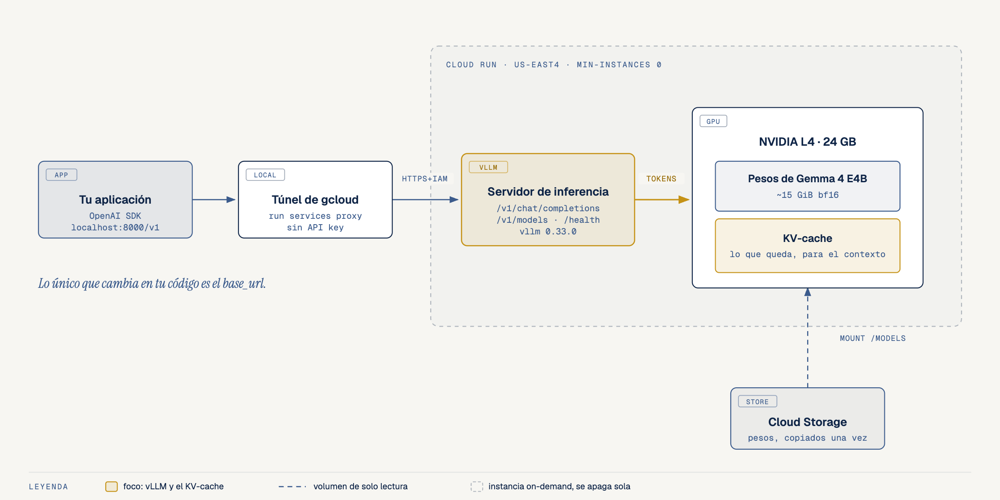
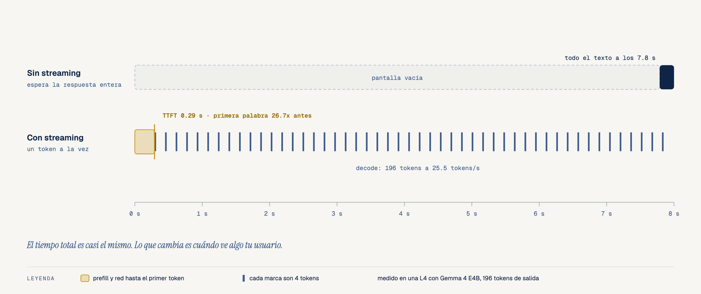
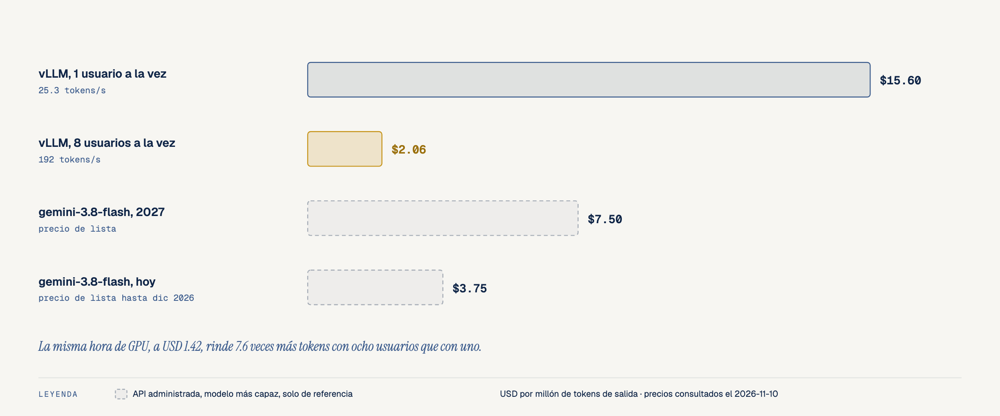

# Tu Primer Servidor vLLM con Gemma: de la API a tu Propia GPU

- **Por qué es relevante:** Si ya llamaste una API de IA, ya sabes casi todo. Aquí pones el modelo de tu lado: Gemma 4 corriendo en una GPU tuya en Google Cloud, con la misma API que ya usas. Tu código cambia una línea, el `base_url`, y a cambio ganas control sobre los datos, la versión del modelo y el costo.
- **Para quién es:** Desarrolladores que saben Python y han llamado una API de IA, pero nunca levantaron un modelo propio. No hace falta machine learning.
- **Qué vas a medir:** el tiempo al primer token (TTFT), los tokens por segundo, la diferencia entre leer el prompt (prefill) y escribir la respuesta (decode), y cuánto cuesta un millón de tokens con 1 y con 8 usuarios.
- **Serie completa:** unidad C1 de la Serie C, [Field Guide: Servir Modelos Abiertos con vLLM](https://github.com/ykro/vllm-for-software-devs-field-guide).

---

## El modelo mental

### 1. Tu app habla con la misma API de siempre, y del otro lado hay una GPU tuya

vLLM carga los pesos de Gemma en la GPU y expone `/v1/chat/completions`, `/v1/models` y `/health`, las mismas rutas que la API de OpenAI. Cloud Run lo corre con una NVIDIA L4 on-demand (`min-instances 0`), y un túnel de `gcloud` lo deja en `localhost:8000` firmado con tu identidad, sin URL pública ni API key en el código. La memoria de la GPU se reparte entre los pesos (unos 15 GiB) y el KV-cache, la memoria de trabajo del contexto.



### 2. Leer es barato y escribir es caro

El modelo lee todo el prompt de golpe (prefill) y después escribe un token a la vez (decode). Del prefill sale el tiempo al primer token; del decode, la velocidad del resto de la respuesta. Con streaming la primera palabra aparece después del TTFT en lugar de al final.



### 3. Tu GPU cobra por hora

La instancia cuesta lo mismo por hora con uno o con ocho usuarios. El costo por token depende de cuántos tokens le sacas a cada hora.



---

## Resultados reales (`verify_first_server.py`)

Corrida del 2026-11-10 contra vLLM `0.33.0` con `google/gemma-4-E4B-it` en bf16, Cloud Run en `us-east4` con 1 NVIDIA L4 (8 vCPU, 32 GiB), desde una laptop en Guatemala a través del túnel. Los tiempos incluyen la ida y vuelta por la red y cambian de una corrida a otra; las verificaciones revisan comportamiento y las cifras exactas quedan en el JSON.

| Experimento | Archivo | Qué se mide | Resultado |
| :--- | :--- | :--- | :--- |
| **01. El modelo es un endpoint HTTP** | `experiments/01_hello_vllm_over_http.py` | `GET /v1/models` y una pregunta con `urllib`, sin SDK | 22 tokens de entrada, 31 de salida, **1.45 s** |
| **02. Mismo código, otro servidor** | `experiments/02_same_code_any_provider.py` | Una función de app con el cliente de OpenAI; solo cambia `base_url` | Resumen correcto del ticket, **idéntico** dos veces con `temperature=0` y `seed` |
| **03. Streaming y TTFT** | `experiments/03_streaming_ttft.py` | La misma respuesta de 200 tokens, esperando completa y con streaming | Completa a los **7.50 s**; con streaming el primer token a los **0.30 s** (**25x** antes), **25.8 tokens/s** |
| **04. Prefill contra decode** | `experiments/04_prefill_vs_decode.py` | TTFT con prompts de 104 a 7,230 tokens; tiempo total con 16 a 256 tokens de salida | TTFT de **0.30 s a 1.83 s**; prefill a unos **4,600 tokens/s** contra decode a **26 tokens/s** (**178x**) |
| **05. Costo por millón de tokens** | `experiments/05_cost_per_million_tokens.py` | Tokens de salida por segundo con 1 y con 8 usuarios, y el precio de la instancia | **USD 15.60** con 1 usuario, **USD 2.04** con 8 (**7.6x** más throughput) |

Salida íntegra del juez (la misma corrida que `benchmarks/latest_results.json`):

```text
====================================================================================================
THE OUTSIDE JUDGE — Your First vLLM Server with Gemma
====================================================================================================
Mode    : live
Server  : vLLM 0.33.0 | model /models/google/gemma-4-E4B-it served as 'gemma' | max_model_len 8192
Client  : Python 3.12.11 | Darwin arm64
----------------------------------------------------------------------------------------------------
Experiment                       | Measured                           | Result               | Check
----------------------------------------------------------------------------------------------------
01. Model over plain HTTP        | gemma (53 tok)                     | 1.45 s               | PASS
02. Same code, OpenAI SDK        | summary at temperature 0           | repeatable           | PASS
03. Streaming vs blocking        | TTFT 0.300 s                       | 25.8 tok/s           | PASS
04. Prefill vs decode            | 104->7230 tok: 0.299->1.833 s      | read 178x faster     | PASS
05. Cost per 1M output tokens    | 1 user $15.60                      | 8 users $2.04        | PASS
----------------------------------------------------------------------------------------------------
Times include the network round trip through the tunnel and vary run to run.
Prices: Cloud Run, 1 NVIDIA L4 (sin redundancia zonal), 8 vCPU, 32 GiB, instance-based billing, $1.4209/h list price checked 2026-11-10.
ALL CHECKS PASSED.
```

### Cómo leer estas cifras

- **El piso de red.** El TTFT de un prompt corto (0.30 s) es casi todo ida y vuelta por el túnel y la cola del servidor. Por eso el experimento 04 calcula la velocidad del prefill con la pendiente entre el prompt más corto y el más largo, que descuenta ese piso.
- **Prefix caching.** vLLM guarda el KV-cache de los prompts que ya leyó y reutiliza los comienzos repetidos. Para medir el prefill real, cada prompt de los experimentos empieza con un identificador único (`fresh()` en `vllm_lab/client.py`). Sin eso, la segunda corrida parece tres veces más rápida. El tema completo está en C3.
- **Un usuario deja la GPU ociosa.** Con un usuario la L4 escribe 25 tokens/s; con ocho, 193 tokens/s en total, con casi la misma velocidad por usuario. Esa es la razón del precio por millón: la hora cuesta lo mismo.
- **Precios.** `benchmarks/pricing.json` guarda el precio de lista de Cloud Run (USD 1.42 por hora por la L4, 8 vCPU y 32 GiB, consultado el 2026-11-10) y su fuente. No incluye descuentos ni el tiempo encendido sin tráfico.
- **Arranque en frío.** Con `min-instances 0`, la primera petición enciende la instancia. En nuestras pruebas tomó entre 8 y 9 minutos: unos 260 s para traer los 15 GiB de pesos (lo mismo desde Hugging Face que desde el bucket montado), unos 55 s de compilación y el resto en preparar el motor. Acelerarlo es parte de C5.

---

## Cómo correrlo

### 1. Sin GPU (servidor falso)

```bash
git clone https://github.com/ykro/first-vllm-server-with-gemma.git
cd first-vllm-server-with-gemma
python -m venv .venv && source .venv/bin/activate
pip install -e ".[dev]"
make all          # ruff + pytest + juez contra el servidor falso
```

El servidor falso (`vllm_lab/mock_server.py`) habla el mismo HTTP que vLLM y simula el prefill y el decode. Sus números son inventados a propósito; sirve para entender el código y correr los tests gratis.

### 2. Con tu propia GPU en Cloud Run

Necesitas un proyecto de Google Cloud con cuota de GPU L4 para Cloud Run en la región que uses (por defecto `us-east4`).

```bash
export GCP_PROJECT_ID=tu-proyecto
make stage        # copia una vez los pesos de Gemma a Cloud Storage (Cloud Build, unos 4 min)
make deploy       # despliega la imagen oficial de vLLM con una L4, min-instances 0
make warm         # opcional: mantiene una GPU encendida mientras trabajas (USD 1.42 por hora)
make tunnel       # en otra terminal: localhost:8000 -> tu servicio
make verify-live  # el juez contra la GPU real; escribe benchmarks/
make cool         # vuelve a min-instances 0 al terminar la sesión
make teardown     # borra el servicio cuando ya no lo uses
```

Cada experimento también corre solo, por ejemplo `python experiments/03_streaming_ttft.py` (o con `--mock`).

---

## Estructura

```text
vllm_lab/        cliente (OpenAI SDK + medición de streaming), CLI común y servidor falso
experiments/     01 a 05, cada uno con run(base_url) y --mock
verify_first_server.py   el juez
tests/           pytest contra el servidor falso
gcp/             stage_weights.sh, deploy_vllm.sh, teardown.sh
benchmarks/      pricing.json y los resultados de la corrida en vivo
diagrams/        los tres diagramas (HTML, SVG y PNG)
```

---

## Videos y artículos

- **YouTube**: Próximamente.
- **Substack (`ykro1.substack.com`)**: Próximamente.
